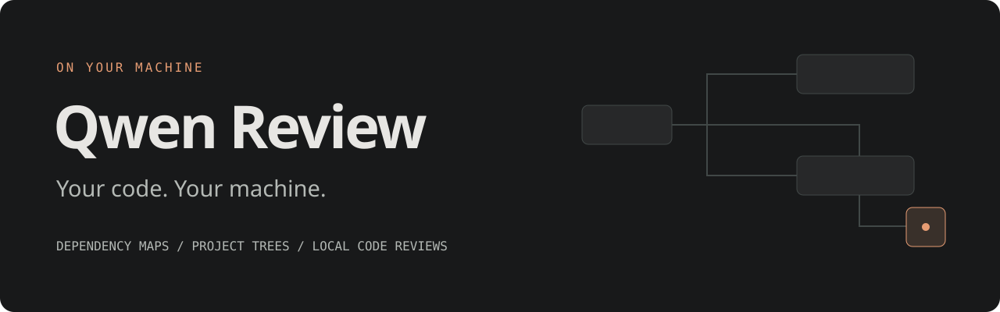
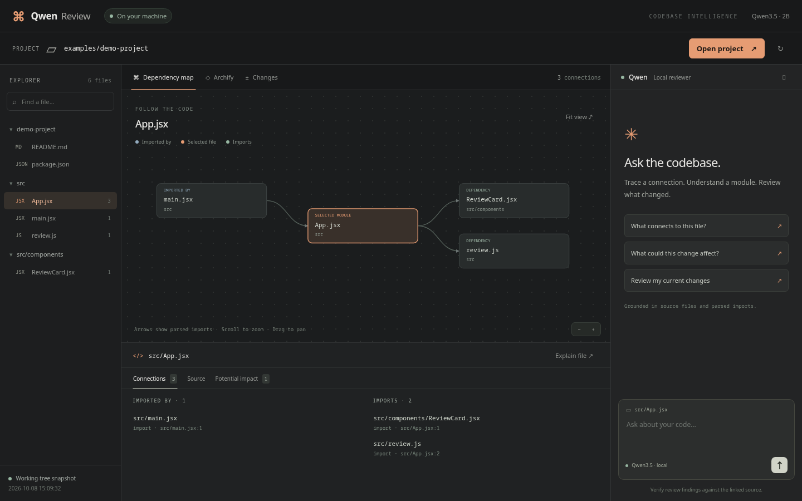
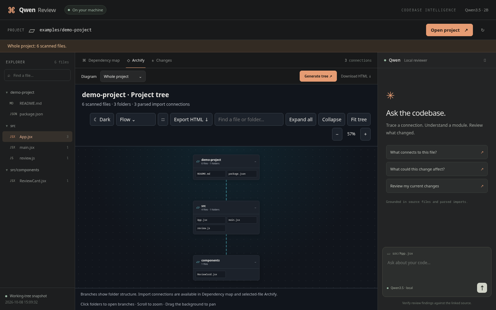
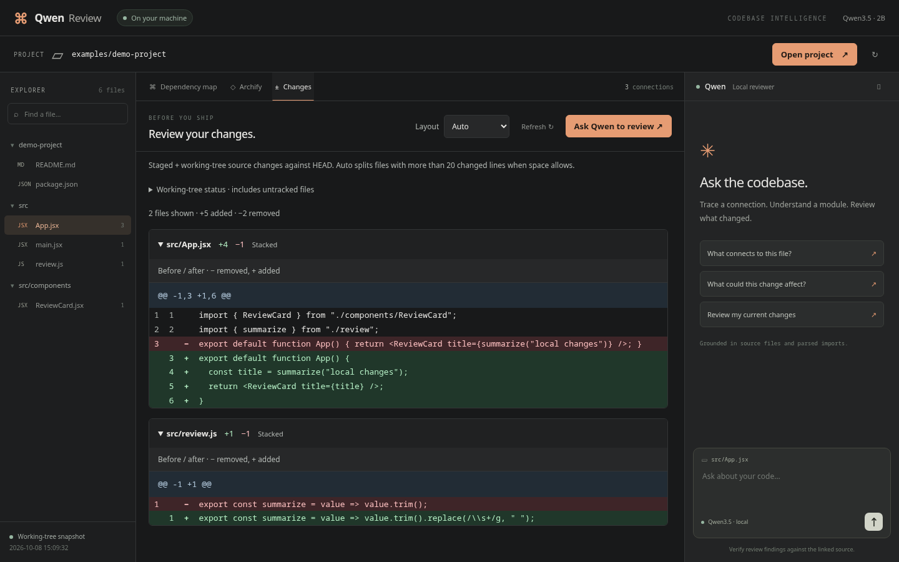
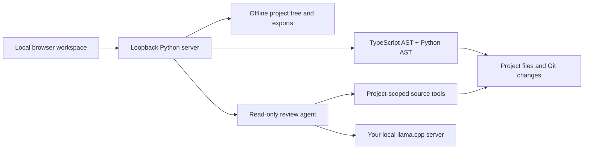

<p align="center">
  
</p>

<p align="center">
  <strong>A local workspace for understanding code, following dependencies, and reviewing changes.</strong><br>
  Real source files. Parsed connections. Your own local model.
</p>

<p align="center">
  <a href="#quick-start">Quick start</a> ·
  <a href="#what-you-can-do">Features</a> ·
  <a href="#screenshots">Screenshots</a> ·
  <a href="#how-it-works">Architecture</a> ·
  <a href="#development">Contributing</a>
</p>

---

Qwen Review brings your project explorer, import graph, Git diff, and local AI reviewer into one dark workspace. Open a folder, select a file, and follow the code. Ask where it connects, what a change could affect, or whether your current diff contains an actionable issue.

**This repository contains the review system only.** Model weights, llama.cpp binaries, personal memory, desktop configuration, and chat history are not bundled. The UI, parser, project tree, and diff viewer work without a model; AI replies require your own local llama.cpp server.

## What you can do

| Surface | What it does |
| --- | --- |
| **Dependency map** | Shows a file's parsed imports and incoming imports. Click nodes to explore connected files. |
| **Project tree** | Displays the folder hierarchy with expandable branches, compact file grids, search, pan, zoom, and Fit tree. |
| **Git review** | Compares staged and unstaged tracked source changes against `HEAD`, with line numbers and clear `+` / `−` markers. |
| **Adaptive diff layout** | Uses stacked lines for small changes and split columns for larger ones when space allows. Override it whenever you want. |
| **Source and impact** | Reads numbered source lines and lists transitive import dependents. |
| **Local reviewer** | Reads files and Git evidence through project-scoped tools, with clickable source citations. |
| **Presentation** | Classic, animated Flow, Blueprint, and Editorial tree styles; light/dark themes and fullscreen. |
| **Offline exports** | Downloads a self-contained interactive project tree as HTML. Selected-file Archify diagrams are optional. |

## Screenshots

These screenshots use the small example project included in this repository.



<details>
<summary><strong>Project tree · Flow presentation</strong></summary>



</details>

<details>
<summary><strong>Git changes · before and after</strong></summary>



</details>

## Quick start

### 1. Install the system

Requirements: **Python 3.11+**, **Node.js 20+**, **Git**, and **ripgrep**. Linux is the tested platform.

```bash
git clone https://github.com/justrhey/qwen-review.git
cd qwen-review
npm ci
npm start
```

Open **http://127.0.0.1:8766**, enter an absolute project directory, and click **Open project**.

To explore the included fixture, open the absolute path to `examples/demo-project` inside your checkout. The fixture demonstrates parsed connections; it is not a separately configured application.

You can browse maps, trees, source, and Git changes immediately. A Git repository needs an existing commit for comparisons against `HEAD`.

### 2. Connect your local model

Start your own llama.cpp server with a tool-capable model and an alias of `qwen-local`. For example, with an existing Qwen GGUF file:

```bash
llama-server \
  --model /absolute/path/to/your-model.gguf \
  --alias qwen-local \
  --host 127.0.0.1 \
  --port 8080 \
  --ctx-size 8192 \
  --parallel 1 \
  --jinja \
  --reasoning off
```

The reference setup uses **Qwen3.5-2B**, but this repo does not download or distribute it. Model behavior, speed, and memory requirements depend on the model and your hardware.

The agent uses llama.cpp's `/apply-template` and `/tokenize` endpoints as well as `/v1/chat/completions`. An arbitrary OpenAI-compatible endpoint alone is not sufficient.

If your local server uses a different port:

```bash
QWEN_MODEL_API=http://127.0.0.1:8081 npm start
```

After the dependencies and model are installed, the app runs offline. GitHub cloning, initial package installation, and obtaining a model require internet access.

### 3. Optional: selected-file Archify diagrams

The whole-project tree has no Archify dependency. For selected-file import diagrams, install [Archify](https://github.com/tt-a1i/archify) separately:

```bash
git clone https://github.com/tt-a1i/archify.git "$HOME/archify"
```

Follow Archify's own installation instructions. The default CLI location is `~/archify/archify/bin/archify.mjs`. To use another checkout:

```bash
ARCHIFY_CLI=/absolute/path/to/archify/bin/archify.mjs npm start
```

## Try asking

- “What imports `src/App.jsx`, and what does it import?”
- “Read `src/review.js` and explain its purpose. Cite source lines.”
- “What could be affected if I change this file?”
- “Review my current Git changes. Read the relevant source and report only supported issues.”

The runtime reads explicitly named files before asking the model to review them. It also reads Git evidence for change-review requests and can recover when the model asks you to run a reader it already has access to. These are tool and context improvements, **not model training**. Review answers still need human verification.

## How it works



**Edges come from source parsing.** The model explains evidence; it does not invent the dependency graph. JS/TS parsing covers imports, re-exports, literal dynamic imports, `require`, and project aliases. Python parsing uses the standard `ast` module.

**Tree branches show containment.** They represent folders and files, rather than runtime execution or import relationships. Use Dependency map for imports.

**Workspace tools are read-only.** The model can inspect source, dependencies, and Git diffs, and create diagram artifacts. The published agent contains no source-editing, shell-command, personal-memory, or desktop-sidebar tools.

## Scope and privacy

- The web server listens on loopback, with host/origin checks and a per-process workspace token.
- Scans respect `.gitignore` and exclude hidden paths, recognized credential files, symlinks, common dependency/build folders, binaries, and oversized files. This filtering is not a complete secret detector.
- Scans cover supported source extensions, up to **1,500 files**, with a **1 MiB** per-file limit.
- The dependency map displays up to **12 neighbors per side**. Connection lists retain the scanned relationships. Selected-file Archify diagrams display up to **24 neighbors**.
- Git patches are bounded to **40,000 bytes**; partial results are marked. Untracked source is listed separately and is not included in the tracked diff.
- Dynamic/computed dependencies and framework routing conventions may be unresolved. Import reach is potential impact, not proof that a runtime behavior will break.
- Chat history stays in browser storage. Request/tool audit logs live under `~/.local/state/local-qwen/reviews/`; diagrams live under `~/.local/state/local-qwen/diagrams/`.
- No upload or telemetry is implemented. Keep the model endpoint local to preserve offline operation.
- Small local models can misread source or produce invalid tool requests. Unsupported requests are not executed, and claims are not substitutes for tests.

## Configuration

| Variable | Default | Purpose |
| --- | --- | --- |
| `QWEN_WORKSPACE_PORT` | `8766` | Browser workspace port. |
| `QWEN_MODEL_API` | `http://127.0.0.1:8080` | Base URL of your local llama.cpp server. |
| `ARCHIFY_CLI` | `~/archify/archify/bin/archify.mjs` | Optional selected-file diagram renderer. |

## Development

```bash
npm ci
npm test
```

Tests cover AST relationships, aliases, source exclusions, cyclic dependents, Git changes, project scope, source-read recovery, streamed tool arguments, context trimming, inline-data escaping, and diff alignment. CI runs Python and Node tests; it does not claim live model evaluation or browser coverage.

The project uses Python's standard library, plain HTML/CSS/JavaScript, and the TypeScript compiler API. No frontend framework or bundler is required.

```text
qwen-review/
├── agent.py                  # Project-only local model tool runtime
├── repository_tools.py       # Source reads, graph, Git diff, diagrams
├── repo-scan.cjs              # TypeScript AST parser
├── workspace.py              # Loopback HTTP server
├── workspace/                # Browser UI, diff parser, project tree
├── examples/demo-project/    # Tiny codebase for exploring the UI
├── tests/                    # Node diff tests
└── test_*.py                 # Python tests
```

Small, focused pull requests are welcome. Explain the behavior you changed, include relevant validation, and provide screenshots for UI changes. Report reproducible bugs with your platform, steps, and sanitized example source; avoid attaching private code or chat traces.

## Credits

Built with [Python](https://www.python.org/), the [TypeScript compiler API](https://github.com/microsoft/TypeScript), and [llama.cpp](https://github.com/ggml-org/llama.cpp). Optional import-diagram rendering uses [Archify](https://github.com/tt-a1i/archify). The codebase workspace was inspired by [Cartograph](https://github.com/adrianhajdin/cartograph).

[Qwen](https://github.com/QwenLM) provides the reference model family. Third-party models, libraries, and renderers retain their own licenses and are not redistributed here as model/runtime binaries.
